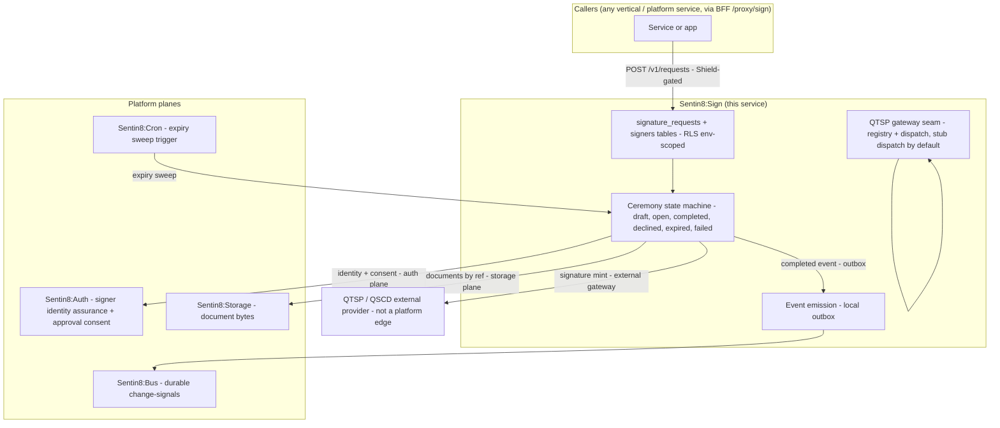

# Design Doc: Sentin8:Sign - Electronic Signature Ceremonies

## 1. Summary

Sentin8:Sign is the platform's **electronic signature ceremony service**.
A signature request (document set + signer set + signature level) is
created, each signer is driven through an approval-style ceremony (the
auth plane's session + consent machinery guarantees the signer's
identity assurance), the signature itself is minted by a **QTSP gateway
seam** (any qualified trust-service provider - the service ships a stub
dispatch behind the same seam, mirroring Post's gateway model), and the
resulting signature evidence is durably retained per tenant with a
complete audit trail. Events emit on the Bus so any consuming vertical
(or platform service) can react to signature completion.

## 2. Motivation

- **E-signature is a cross-vertical platform concern, not a vertical
  feature.** Contracts (hospitality), account openings (banking),
  trade confirmations (trading) all need the same ceremony machinery -
  duplicating it per vertical is the defect the platform exists to
  avoid.
- **The identity plane must stay pure.** A signature request is a
  business-domain record (documents, signers, evidence) - auth is the
  identity-assurance and consent provider, never the record owner.
- **One ceremony engine, many signature levels.** AdES (Advanced) and
  QES (Qualified) differ only in the trust-service provider behind the
  gateway seam and the signer's assurance level - the ceremony state
  machine is shared.
- **Durable evidence.** A signature that cannot be produced later with
  its full ceremony evidence (who signed, when, what they saw, how they
  were authenticated) is legally worthless. The record-of-truth rides
  the platform's standard durability (Postgres + outbox + audit
  journal).

## 3. Architecture & High-Level Design

### Key traits and data structures

- `SignatureRequest` (state machine): the durable record - documents
  (storage refs), signers (user ids + required assurance level), the
  requested signature level (`ades` | `qes`), and its terminal evidence
  (signature value + provider attestation) once complete.
- `Signer`: per-signer ceremony record - approval token, viewed/signed
  timestamps, session binding (approval cannot be replayed across
  sessions, same rule as CIBA).
- `Gateway dispatch trait`: one seam, many providers - stub dispatch
  (dev/test) and QTSP remote-signing adapters (any trust-service
  provider configured per environment) behind the same interface, with
  credentials by `secret_ref` only (never plaintext in tables).
- **Events**: `sentin8:sign:request:created`, `:viewed`, `:signed`,
  `:completed`, `:declined`, `:expired`, `:failed` - payload-complete
  (request id, signer, document refs, level) so consumers never call
  back.

## 4. Rationale, Trade-offs, and Alternatives

- **Service, not library.** The ceremony needs durable state, a state
  machine, event emission, background expiry, and an external provider
  boundary - every library criterion fails; it is structurally
  identical to Post (durable inbox → gateway seam → retry/DLQ → events)
  and Acme (cert lifecycle behind a provider boundary).
- **Verification as a library** (future SDK crate): consumers verify
  completed signatures in-process on their hot paths (runtime
  dependency discipline - handlers never call another service
  synchronously); the service keeps only the ceremony + evidence
  retention.
- **Gateway seam over hardcoded providers.** Same pattern as Post's
  channel gateways - the platform never hardcodes a trust-service
  provider; per-env configuration selects one; the stub exercises the
  machinery end-to-end without an external dependency.
- **Auth approval-reuse over a new consent page.** The signer's
  approval binds to their session (CIBA-shaped machinery already
  guarantees anti-replay) - no parallel consent surface is invented.
- **Rejected: library-only.** No durable evidence, no events, no
  expiry - the legally-required record-of-truth cannot live in a
  caller's process.
- **Rejected: per-vertical implementations.** Violates the
  zero-vertical-duplication rule and the platform's single-ceremony
  ownership of signing (the auth BUSINESS.md "delegated to bank8" note
  was a vertical reference inside core platform docs - a defect fixed
  by this service).

## 5. Internal Implementation & Invariants

- **RLS env-scoped tables** with the standard tenant-match policy;
  `FORCE ROW LEVEL SECURITY` on every table.
- **Approvals bind to the signer's session** - a replayed or
  cross-session approval is rejected.
- **Documents by storage reference only** - never inline document
  bytes in application tables.
- **Gateway credentials by `secret_ref`** (`backend://path`) - never
  plaintext in rows, resolved at dispatch time through the Secrets
  chain, zeroize-on-drop.
- **Evidence retention** - the completed signature + ceremony evidence
  is append-only; no mutation path after completion.
- **State machine transitions are single-transaction**: request row +
  signer row + outbox event row commit together.
- **Expiry sweep** - a Cron proxy-back schedule flips stale `open`
  requests to `expired` daily.
- No `unsafe` code.

## 6. Testing Strategy

- Unit: state machine transitions, session binding, payload shapes.
- Integration (DB-backed, `make infra-up` + `vertical init`):
  ceremony round-trip, RLS tenant isolation, event emission shape.
- Drift guard: OpenAPI spec covers every served route (the platform's
  standard `openapi_drift.rs` test).
- Provider dispatch: the stub adapter exercises the full path
  end-to-end without an external QTSP.

## 7. Unresolved Questions / Future Designs

- The verification library (`sdk/crates/sign` verification primitives)
  ships as the consumer-side hot-path surface; deep AdES-format
  verification (PAdES/XAdES container validation) rides the same seam
  behind provider adapters.
- Webhook-style callbacks to the requester on completion - today the
  Bus events carry completion; a push callback surface may follow.
- Multi-document packages (sign once, N documents) - the request
  model already carries a document set; package-level single-signature
  semantics follow.

---

**Architecture & Design:** Sentin8:Sign and its underlying concepts were
designed by [Hamid Jahanzad](https://www.linkedin.com/in/hamidjahanzad/).